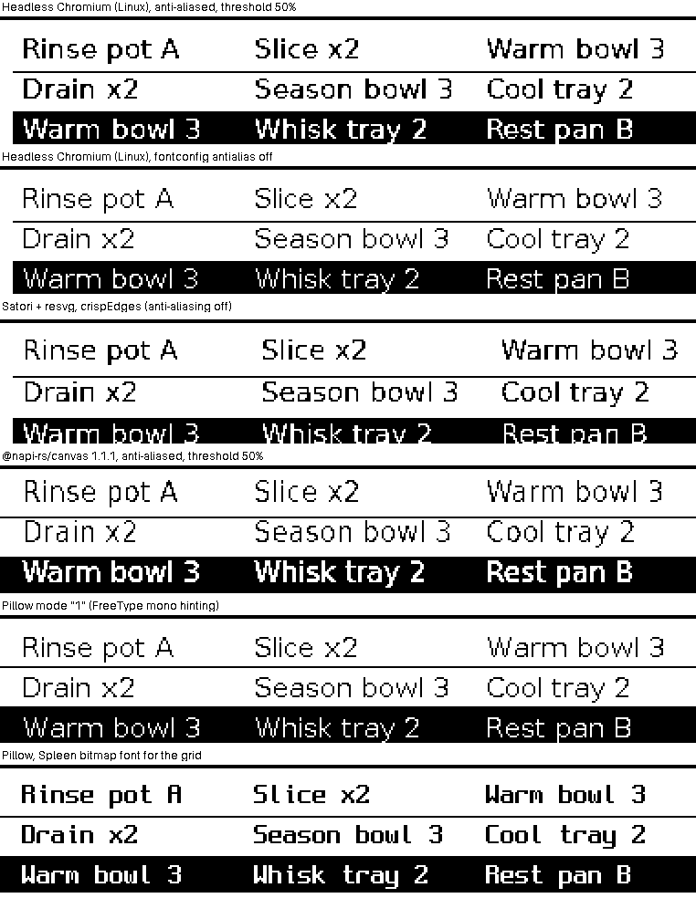

# Rendering legible 1-bit frames on a server

Checked 2026-11-20. Facts come from source repositories read at the pinned commits linked below, first-party documentation and the font projects' own pages. Frame times, memory figures and the 1-bit crops are this note's own measurements, marked "measured": they were taken on the owner's Windows PC with invented fixture text, not on a Raspberry Pi ([How it was measured](#how-it-was-measured)). "My reading" marks interpretation. Anything not confirmed is marked UNVERIFIED and collected at the end.

**How strong the evidence is.** Strong for what each renderer can do with anti-aliasing and hinting: read from source and checked in renders. Medium for speed: no renderer publishes a frame time at 800×480 or 1872×1404, so the times come from a desktop CPU. Thin for small hosts: nothing was measured on a Raspberry Pi, and the only figure found is one user report.

This note builds on [software-prior-art.md §4][prior] (TRMNL, its servers, image formats and byte caps) and on the device-UI prototype, which thresholds a browser render [proto]. Rendering on the terminal itself is option C of [interactive-epaper-clients-esp32.md][esp32-clients].

## Key findings

1. **Thresholding anti-aliased text is the weak step.** It makes stroke weight depend on the threshold and on polarity: in the @napi-rs/canvas crop below, white-on-black text comes out bolder than black-on-white, and Chromium's thresholded strokes are uneven (measured). Dithering is worse for text: it "speckles flat greys and frays glyph edges" [ku-0045].
2. **FreeType's monochrome hinting avoids it, and options 1 and 3 can use it.** Pillow uses it on mode "1" images [pil-draw] [pil-ft]. Skia uses it for glyphs drawn without anti-aliasing, unless hinting is off [skia-ft]. Headless Chromium on Linux draws that way when a fontconfig file turns anti-aliasing off: the frames had no grey pixel, for a system font and a web font alike (measured). In this mode the result is "completely up to the font's programming" [ft-ttgload], so the font's own hints decide quality.
3. **Satori with resvg cannot hint.** resvg has "no native text rendering" [resvg], so glyph outlines are rasterised unhinted. `crispEdges` removes the grey, but stems then jump between 1 and 2 px at 3 mm (measured).
4. **Warm frames are fast everywhere; cold browsers are not.** On the PC a warm frame took 3–10 ms with Pillow or a 2D canvas, 30–39 ms with Satori and resvg, and about 85 ms with headless Chromium at 800×480; at 1872×1404, 15–27, 78–92 and 115–165 ms (measured). Launching a browser per render costs "seconds of start-up per render on a small self-hosted machine" [ku-0044]. InkyPi's maintainer names Chromium "one of the major causes of freezing and crashes on the pi zero 2w" [ip-478].
5. **Pixel fonts only work at their native sizes.** TRMNL uses them for small text on its 800×480 models and Inter for all text on its 1872×1404 one, "because pixel bundles only render correctly at their native sizes" [tf-size] [tr-models]. At 227 ppi every outline renderer was legible in 1-bit (measured), as the prototype found [proto].
6. **The prototype's 150 ppi verdict rests on thresholded renders.** Its finding that the process grid's small text "wants 150 ppi or more" [proto] came from a thresholded browser render. Aliased, hinted or pixel-font renders at 124 ppi have not been judged on a panel (my reading).

## Comparison

All frame times are warm medians to a 1-bit PNG, measured on the PC. Each column is one option below.

| | 1. Headless Chromium | 2. Satori + resvg | 3. 2D library: Skia, Cairo or Pillow | 4. Pixel fonts |
|---|---|---|---|---|
| In use by | Terminus, LaraPaper, Kuroshiro, Inker, BYOS Phoenix, InkyPi, the prototype | BYOS Next.js, which defaults to Takumi | BYOS FastAPI (Pillow) | TRMNL Framework, for small text |
| Frame, 800×480 | 83 ms screenshot + 3 ms threshold | 30–39 ms | skia-canvas 3.5 ms, node-canvas 6.5 ms, Pillow 10 ms | 3 ms (Pillow, Spleen 8×16) |
| Frame, 1872×1404 | 100–150 ms + 14 ms | 78–92 ms | 15–20, 22–27 and 27 ms | 10 ms (Spleen 12×24) |
| Start-up | 0.3–0.7 s to a ready page. Launching per frame: 0.7–0.9 s (Chrome, Windows), 0.2–0.4 s (`chrome-headless-shell`, Linux) | First frame 0.12–0.23 s | First frame 15–65 ms | As its renderer |
| Text in 1-bit | Anti-aliased by default. On Linux, fontconfig `antialias` off: no grey pixel, FreeType mono hinting | Unhinted outlines. `crispEdges` turns anti-aliasing off | Pillow mode "1": FreeType mono hinting. skia-canvas `fontSmoothing = false`: aliased, on the pixel grid. node-canvas: aliased paths. @napi-rs/canvas: no switch in 1.1.1 | Exact at native size, nothing at other sizes |
| Peak memory (PC) | 0.39–0.43 GB over 8 browser processes, plus the driver | 0.24–0.38 GB at 800×480, 0.7–1.1 GB at 1872×1404, mostly native | skia-canvas 56–150 MB, node-canvas 57–160 MB, Pillow 26–38 MB | As its renderer |
| Small hosts (published) | Seconds per launch [ku-0044]. InkyPi adds zram and earlyoom [ip-install] and still reports freezes [ip-478] | None found | @napi-rs/canvas arm64 needs a Cortex-A57 or newer [napi]; the Pi Zero 2 W has a Cortex-A53 [rpi-z2w] | None found |
| Ecosystem | Any language over CDP: Puppeteer, Playwright, Ferrum, Browsershot. Full HTML and CSS | JavaScript. JSX with a CSS subset: flex, grid, block | Node (skia-canvas, @napi-rs/canvas, node-canvas) or Python (Pillow). No layout engine | BDF, PCF, OTB. Spleen also ships OTF and WOFF |
| Licences | Any font loaded. Inter OFL-1.1 [inter]; DejaVu Bitstream Vera, changes public domain [dejavu] | Satori MPL-2.0; resvg Apache-2.0 or MIT. Fonts: TTF, OTF, WOFF, WOFF2 | skia-canvas, @napi-rs/canvas and node-canvas MIT; Pillow MIT-CMU. Any FreeType font | Spleen BSD-2-Clause, Terminus OFL-1.1, Cozette MIT, TRMNL12/16/21 OFL-1.1, u8g2 per font |

*The same three process-grid rows of the 800×480 fixture frame, cropped from each renderer's 1-bit output and enlarged 2× without smoothing. Invented fixture text in DejaVu Sans at 3 mm (15 px); the third row is the inverted current step. Chromium ran on Linux. The others ran on Windows, but Pillow bundles FreeType, @napi-rs/canvas draws every font with FreeType [napi] and resvg uses no system library [resvg], so Linux should give the same pixels (my reading).*

## Options

### 1. Headless Chromium, with anti-aliasing off

Keep HTML and CSS, as the prototype does [proto], and screenshot a page per frame. Terminus, LaraPaper, Kuroshiro, Inker and BYOS Phoenix do this [te-shoter] [lp-gen] [ku-0044] [inker] [phoenix], as does InkyPi with the Debian `chromium-headless-shell` package [ip-deps]. That is Chrome's old headless mode, a separate binary since Chrome 132 [cr-headless], which "does not require X11/Wayland, D-Bus" [cr-shell]. Keep the browser running. Terminus opens a page per render in one browser and restarts it every 500 renders [te-browser] [te-defaults]. Kuroshiro moved to "one shared, long-lived Chromium" and caps it at four pages, which "bounds memory on a small machine" [ku-0044]. LaraPaper (through Browsershot), BYOS Phoenix and InkyPi launch one per render [browsershot] [phoenix] [ip-shot]. Chromium's text is anti-aliased by default. The headless `--font-render-hinting` switch sets hinting and subpixel positioning, default `full` [cr-switch], and CSS can turn smoothing off only on macOS [mdn-smooth]. On Linux, Chromium reads anti-aliasing from fontconfig [cr-fc] [cr-prefs], in headless mode too [cr-headless-wc]. With a `FONTCONFIG_FILE` that sets `antialias` to false, frames came out with no grey pixel and glyphs that matched Pillow's by eye (measured), so no threshold step is needed. The cost is the browser's memory. InkyPi supports the Pi Zero 2 W [ip-readme], which has 512 MB [rpi-z2w]. It passes flags that cut processes and adds zram swap and earlyoom [ip-shot] [ip-install], and its maintainer still blames Chromium for freezes there [ip-478].

### 2. Satori with resvg

Satori turns JSX into SVG with its own layout (Taffy, for flex, grid and block) and HarfBuzz shaping, and writes text as `<path>` outlines by default [satori]. It is MPL-2.0, at 0.63.2 [satori-npm]. resvg, Apache-2.0 or MIT at 0.50.0, has "no native text rendering" [resvg] [resvg-rel], so neither Satori's outlines nor resvg's own text are hinted (my reading). Its `crispEdges` and `optimizeSpeed` turn anti-aliasing off, and `text-rendering: optimizeSpeed` maps to `crispEdges` [resvg-aa] [resvg-text]. The Node binding takes them as `shapeRendering: 1` and `textRendering: 0` [resvg-js], which is what BYOS Next.js passes when it renders with Satori [bn-satori]. BYOS Next.js defaults to Takumi instead, a Rust engine with layout ported from Blink, MIT or Apache-2.0 [bn-raster] [takumi]. It records that Takumi 1.8.6's PNG encoder corrupts output at 1872×1404, and encodes with sharp instead [bn-takumi]. Memory was the surprise. Capping the JavaScript heap at 128 MB did not lower the peaks in the table. With a garbage collection forced after every frame, Satori alone peaked at 106–149 MB and resvg-js alone at 83–344 MB (measured, resvg-js 2.6.2, published 2024 [resvg-js-npm]). It keeps a CSS-like way to write frames without a browser, on a JavaScript server. Small text needs pixel fonts (option 4) to come out even.

### 3. A 2D library with FreeType's monochrome hinting

Draw each frame at native resolution with no anti-aliasing. These libraries draw lines of text but have no CSS layout, so process-grid columns, and wrapping beyond skia-canvas's experimental `textWrap` [skc-ctx], become our code (my reading). In Python, Pillow (MIT-CMU [pil-lic]) draws text on a mode "1" image with `fontmode = "1"` [pil-draw]. It then loads glyphs with `FT_LOAD_TARGET_MONO` [pil-ft], FreeType's "strong hinting algorithm that should only be used for monochrome output" [ft-load]. BYOS FastAPI draws with Pillow [fastapi]. In Node, skia-canvas 4.0.1 has `fontSmoothing = false`, which "disables AA entirely and aligns each glyph to the pixel grid", and `fontHinting` [skc-ctx]. @napi-rs/canvas 1.1.1 cannot turn text anti-aliasing off; every `textRendering` value still left grey pixels (measured). Its `ctx.antialias = 'none'`, which covers text and sends glyphs down Skia's monochrome path, was merged on 2026-11-20 and is unreleased [napi-aa] [napi-raster] [skia-ft]. node-canvas (Cairo) has `antialias = 'none'`, though Cairo's own setting "does not affect text rendering" [cairo]. With node-canvas's default `textDrawingMode` of `path` [nc], the frame still had no grey pixel (measured); `glyph` mode was not tried. On the PC the canvases drew a frame in under 12 ms, and encoding took the rest (measured). The only published text benchmark found is skia-canvas's own. On an Apple M3, 400 glyphs on a 512×512 canvas took 14 ms with skia-canvas, 19 ms with @napi-rs/canvas and 24 ms with node-canvas [skc-bench] [skc-bench-text].

### 4. Pixel fonts for the process grid, with any of the three

Bitmap fonts are drawn on the pixel grid, so at their native size they need neither anti-aliasing nor hinting. Spleen 8×16 looked crispest of all at 124 ppi (measured, crops above). Native size is also their limit. TRMNL's framework uses its pixel fonts (TRMNL12, TRMNL16, TRMNL21) for the three smallest text sizes on low-density models, and Inter at every size on high-density ones and from `xlarge` up [tf-fonts] [tf-size]. TRMNL X (1872×1404) carries the 2× density class and a 1.8 scale factor; the 800×480 TRMNL OG is 1× [tr-models]. The largest sizes are 16×32 for Terminus [terminus-font] and 32×64 for Spleen [spleen], so a step's large type stays an outline font (my reading). At 227 ppi, Spleen 12×24's one-pixel strokes looked thin (measured). Pillow loads BDF files directly (measured). Browsers and Satori need an outline version, which Spleen ships as OTF and WOFF [spleen]; Cozette's author warns that vectorised bitmap fonts render "terrible on virtually all operating systems" [cozette]. Licences: Spleen BSD-2-Clause [spleen-lic], Terminus OFL-1.1 [terminus-font], Cozette MIT [cozette-lic], TRMNL12/16/21 OFL-1.1 [tf-fonts]. u8g2's fonts carry a licence per group [u8g2-lic]; one group includes Creative Commons NonCommercial fonts [u8g2-bfm2], which ADR 0001's rule on noncommercial licences would exclude (my reading) [adr1].

### Whichever option

- **Dithering is for images, not text.** Kuroshiro dithers only the regions marked with TRMNL's `image-dither` class on an otherwise undithered frame, which trmnl.com does per element [ku-0045]. ImageMagick's `-monochrome`, `-colors` and `-remap` dither unless `+dither` is given [im-opts]. Pillow's `convert("1")` dithers unless passed `dither=Image.Dither.NONE`; `None` means Floyd-Steinberg [pil-image].
- **Frames are small.** The fixture frames were 7–10 KB as 1-bit PNGs at 800×480 and 18–29 KB at 1872×1404 (measured), well under TRMNL's 90,000 and 750,000-byte caps [prior].

## How it was measured

- **Fixture.** A two-line step in 8 mm type over a process grid of invented two-word cells in 3 mm type: 39 and 15 px at 800×480 (124 ppi, 96 cells), 71 and 27 px at 1872×1404 (227 ppi, 210 cells). One grid row is inverted. Each frame changes the step line and the inverted row. DejaVu Sans 2.37 throughout [dejavu]; Spleen 2.3.0 for the pixel-font runs.
- **Host.** The owner's PC: AMD Ryzen 5 5600X, 32 GB, Windows 11; Node 24.13.0, Python 3.14.2. The Linux Chromium runs used WSL2 on the same PC. No Raspberry Pi.
- **Versions.** Chrome 157.0.8103.79 through puppeteer-core 25.18.1; `chrome-headless-shell` 148.0.7778.96; satori 0.63.2 with @resvg/resvg-js 2.6.2; skia-canvas 4.0.1; @napi-rs/canvas 1.1.1; canvas (node-canvas) 3.2.3 with Cairo 1.18.4; Pillow 13.0.0 with FreeType 2.14.3.
- **Frame time.** Median of 30 frames after 5 warm-up frames. A frame is the drawing plus a 1-bit PNG. Pillow writes one itself. The Node renderers' pixels were thresholded at 128 and deflated by a small PNG writer. Chromium's PNG screenshot of a long-lived page was thresholded with Pillow.
- **Memory.** Peak resident memory of the Node or Python process; for Chromium, the working set summed over the browser's processes. Peaks depend on when native buffers are freed, so they bound this harness, not a Pi.
- **Caveats.** node-canvas 3.2.3 did not load the fixture font on Windows and fell back to a system font, so its figures are timing only. Every quality judgement comes from PNGs on a monitor, not from a panel. Scripts, fonts and renders stayed outside the repo.

## UNVERIFIED

- **Small hosts.** No frame time or memory figure was measured on a Raspberry Pi, and no published benchmark of any option on one was found. The only figure is a user report on InkyPi's tracker: on a Pi Zero 2 W, 20–30 s per screenshot when launching a browser each time, 3–5 s with one reused browser [ip-478].
- Whether a Raspberry Pi OS build of Chromium honours a fontconfig `antialias` setting as `chrome-headless-shell` 148 did on x86-64 Linux.
- Which font back end Chrome and skia-canvas use on Windows, and skia-canvas's 1-bit text on Linux. Neither is in the crops for that reason.
- Whether Takumi can turn text anti-aliasing off. Its README and changelogs say nothing about it [takumi].
- Whether node-canvas hints glyph outlines in path mode, and its text quality on Linux.
- Which @napi-rs/canvas release will ship `ctx.antialias`.
- Whether Terminus's undithered 1-bit conversion, `-monochrome` with `-colors 2` and no `+dither` [te-mono], dithers in practice, as ImageMagick's documentation implies [im-opts]. Not run.
- `chrome-headless-shell`'s memory against full Chrome's. Chrome's page says only that it "is in some ways more performant" [cr-shell].
- u8g2: licences were read for six of its font groups only.
- Text quality on the panel itself. It needs the owner's eyes at the fridge.

## Sources

All loaded 2026-11-20.

[prior]: software-prior-art.md
[esp32-clients]: interactive-epaper-clients-esp32.md
[adr1]: ../adr/0001-the-repo-is-public-recipe-content-stays-out.md
[proto]: https://github.com/gariasf/evey/blob/ca72548012a484870aba09c77314339a64fc1cf4/prototype/device-ui/README.md
[te-shoter]: https://github.com/usetrmnl/terminus/blob/8c74430716fa12f0c42d74d26ab24ca6640f799e/app/aspects/screens/shoter.rb
[te-browser]: https://github.com/usetrmnl/terminus/blob/8c74430716fa12f0c42d74d26ab24ca6640f799e/lib/terminus/chromium/browser.rb
[te-defaults]: https://github.com/usetrmnl/terminus/blob/8c74430716fa12f0c42d74d26ab24ca6640f799e/lib/terminus/chromium/defaults.yml
[te-mono]: https://github.com/usetrmnl/terminus/blob/8c74430716fa12f0c42d74d26ab24ca6640f799e/app/aspects/screens/converters/monochrome.rb
[lp-gen]: https://github.com/usetrmnl/larapaper/blob/b0d089d4074f61ca9790a3e999b5b1f79eab2173/app/Services/ImageGenerationService.php
[browsershot]: https://github.com/spatie/browsershot/blob/3a09b2b1c8abda32aa0adf2a0896357acecb778e/bin/browser.cjs
[ku-0044]: https://github.com/usetrmnl/kuroshiro/blob/c295ac140df56b0c4ec0360b4e9fcd2ac62ff3ab/docs/adr/0044-every-render-draws-in-one-shared-long-lived-chromium.md
[ku-0045]: https://github.com/usetrmnl/kuroshiro/blob/c295ac140df56b0c4ec0360b4e9fcd2ac62ff3ab/docs/adr/0045-dithering-is-a-switch-on-the-screen-and-the-plugin-and-a-mashup-derives-it.md
[inker]: https://github.com/usetrmnl/inker/blob/83c72b0c590cca40df9da1c646c3d5693e0028df/backend/src/screen-designer/services/screen-renderer.service.ts
[phoenix]: https://github.com/usetrmnl/byos_phoenix/blob/c7cbc5af947cffe640f4637d781cfbae5e78b0e4/lib/trmnl/screen.ex
[fastapi]: https://github.com/usetrmnl/byos_fastapi/blob/10d16d73f696a26cc9843456adbd558fb4699d91/requirements.txt
[bn-raster]: https://github.com/usetrmnl/byos_next/blob/2511a207b51c3134e027126dd891a82e0e99d103/lib/recipes/render/rasterize.ts
[bn-satori]: https://github.com/usetrmnl/byos_next/blob/2511a207b51c3134e027126dd891a82e0e99d103/lib/recipes/renderers/satori.ts
[bn-takumi]: https://github.com/usetrmnl/byos_next/blob/2511a207b51c3134e027126dd891a82e0e99d103/lib/recipes/renderers/takumi.ts
[ip-deps]: https://github.com/fatihak/InkyPi/blob/20994119e38b891be0cb6579335a3364dd32982c/install/debian-requirements.txt
[ip-shot]: https://github.com/fatihak/InkyPi/blob/20994119e38b891be0cb6579335a3364dd32982c/src/utils/image_utils.py
[ip-install]: https://github.com/fatihak/InkyPi/blob/20994119e38b891be0cb6579335a3364dd32982c/install/install.sh
[ip-readme]: https://github.com/fatihak/InkyPi/blob/20994119e38b891be0cb6579335a3364dd32982c/README.md
[ip-478]: https://github.com/fatihak/InkyPi/issues/478
[tf-fonts]: https://github.com/usetrmnl/trmnl-framework/blob/07a0b39e41c9a702e3f21834853d68720f96c170/public/framework/docs/3.4/font_family.md
[tf-size]: https://github.com/usetrmnl/trmnl-framework/blob/07a0b39e41c9a702e3f21834853d68720f96c170/public/framework/docs/3.4/text_size.md
[tr-models]: https://trmnl.com/api/models
[cr-switch]: https://github.com/chromium/chromium/blob/083b25e941c9025ca6bdd31a283ee8499c9559d4/headless/public/switches.h
[cr-headless-wc]: https://github.com/chromium/chromium/blob/083b25e941c9025ca6bdd31a283ee8499c9559d4/headless/lib/browser/headless_web_contents_impl.cc
[cr-prefs]: https://github.com/chromium/chromium/blob/083b25e941c9025ca6bdd31a283ee8499c9559d4/content/public/browser/renderer_preferences_util.cc
[cr-fc]: https://github.com/chromium/chromium/blob/083b25e941c9025ca6bdd31a283ee8499c9559d4/ui/gfx/linux/fontconfig_util.cc
[cr-headless]: https://developer.chrome.com/docs/chromium/headless
[cr-shell]: https://developer.chrome.com/blog/chrome-headless-shell
[mdn-smooth]: https://developer.mozilla.org/en-US/docs/Web/CSS/font-smooth
[skia-ft]: https://github.com/google/skia/blob/42772adba19bee7bdecbea487f14d9d6627b75dc/src/ports/SkFontHost_FreeType.cpp
[satori]: https://github.com/vercel/satori/blob/074f0b38ed0f5d8fa768f709c0bb072b2d6c99e1/README.md
[satori-npm]: https://registry.npmjs.org/satori
[resvg]: https://github.com/linebender/resvg/blob/433d0213a98d611793d105e08e141325e13720e3/README.md
[resvg-aa]: https://github.com/linebender/resvg/blob/433d0213a98d611793d105e08e141325e13720e3/crates/usvg/src/tree/mod.rs
[resvg-text]: https://github.com/linebender/resvg/blob/433d0213a98d611793d105e08e141325e13720e3/crates/usvg/src/text/flatten.rs
[resvg-rel]: https://github.com/linebender/resvg/releases/tag/v0.50.0
[resvg-js]: https://github.com/thx/resvg-js/blob/9de8ddd9dd62293006d849dd846a3b91ba992f23/index.d.ts
[resvg-js-npm]: https://registry.npmjs.org/@resvg%2fresvg-js
[takumi]: https://github.com/kane50613/takumi/blob/d37ab42f2cb05aa9053802ef148ed83d479e8724/README.md
[skc-ctx]: https://github.com/samizdatco/skia-canvas/blob/d5e44a3841a1b0830e48029f47b8552a76ae92b4/docs/api/context.md
[skc-bench]: https://github.com/samizdatco/canvas-benchmarks/blob/97227430c638abe4002ab028fcf7d84dec60475f/results/darwin-arm64/2026-10-01/index.md
[skc-bench-text]: https://github.com/samizdatco/canvas-benchmarks/blob/97227430c638abe4002ab028fcf7d84dec60475f/tests/text.js
[napi]: https://github.com/Brooooooklyn/canvas/blob/7d290bd3034f7db7367e774f4589d69882d739eb/README.md
[napi-aa]: https://github.com/Brooooooklyn/canvas/commit/0e6a445275a3ca93f748fb3006451df981e0c385
[napi-raster]: https://github.com/Brooooooklyn/canvas/blob/7d290bd3034f7db7367e774f4589d69882d739eb/skia-c/text_raster.cpp
[nc]: https://github.com/Automattic/node-canvas/blob/efd824343c84071e26b0a132a6c6c2fcb88399fb/README.md
[cairo]: https://www.cairographics.org/manual/cairo-cairo-t.html
[pil-draw]: https://github.com/python-pillow/Pillow/blob/13.0.0/src/PIL/ImageDraw.py
[pil-ft]: https://github.com/python-pillow/Pillow/blob/13.0.0/src/_imagingft.c
[pil-image]: https://github.com/python-pillow/Pillow/blob/13.0.0/src/PIL/Image.py
[pil-lic]: https://github.com/python-pillow/Pillow/blob/13.0.0/LICENSE
[ft-load]: https://freetype.org/freetype2/docs/reference/ft2-glyph_retrieval.html
[ft-ttgload]: https://github.com/freetype/freetype/blob/VER-2-14-3/src/truetype/ttgload.c
[im-opts]: https://imagemagick.org/command-line-options/
[spleen]: https://github.com/fcambus/spleen/blob/b2d04a6180d44f47396dc530f3b2ca46b87e618b/README.md
[spleen-lic]: https://github.com/fcambus/spleen/blob/b2d04a6180d44f47396dc530f3b2ca46b87e618b/LICENSE
[terminus-font]: https://terminus-font.sourceforge.net/
[cozette]: https://github.com/the-moonwitch/Cozette/blob/4808ce9d5a30c19437730efdc7862db03792a591/README.md
[cozette-lic]: https://github.com/the-moonwitch/Cozette/blob/4808ce9d5a30c19437730efdc7862db03792a591/LICENSE
[u8g2-lic]: https://github.com/olikraus/u8g2/blob/d6c8499c5f2707cac8eccd09fd8f677d12b17977/LICENSE
[u8g2-bfm2]: https://github.com/olikraus/u8g2/wiki/fntgrpbitfontmaker2
[inter]: https://github.com/rsms/inter/blob/353b61b9f4430d5f420d56605a6e7993e0941470/LICENSE.txt
[dejavu]: https://github.com/dejavu-fonts/dejavu-fonts/blob/9b5d1b2ffeec20c7b46aa89c0223d783c02762cf/LICENSE
[rpi-z2w]: https://www.raspberrypi.com/products/raspberry-pi-zero-2-w/

Source notes:

- `[ip-478]`: a GitHub issue. The maintainer's sentence is quoted as written; the 20–30 s and 3–5 s figures are another user's report, not a benchmark.
- `[tr-models]`: TRMNL's live model list, read as JSON. `scale_factor` and the `density` class come from its `v2` (TRMNL X) and `og_png` entries.
- `[satori-npm]`, `[resvg-js-npm]`: versions and publication dates from the npm registry.
